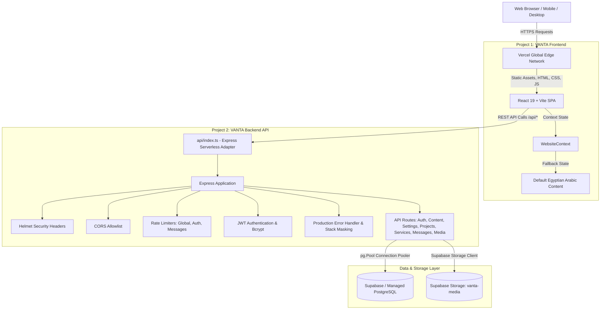

# 🏛️ Architecture Map — VANTA Agency V2.0

Comprehensive architectural blueprint of the VANTA Agency V2.0 full-stack web application.

---

## 1. System Topology Overview

---

## 2. Frontend Architecture (`frontend/`)

### 2.1 Core Technologies
- **Runtime / Framework**: React 18/19, TypeScript 5.2, Vite 5.3.
- **Styling**: Tailwind CSS v4 (`@tailwindcss/postcss`) with custom dark-mode design system.
- **Routing**: `react-router-dom` v6 with SPA client rewrites defined in `vercel.json`.
- **Icons**: `lucide-react`.
- **HTTP Client**: `axios` instance configured with base URL from `VITE_API_URL` and automatic JWT header injection.

### 2.2 Route Structure
| Route | Access | Component | Purpose |
|---|---|---|---|
| `/` | Public | `HomePage` | Agency showcase, hero, services, portfolio, workflow, contact form |
| `/admin/login` | Public | `LoginPage` | Authentication portal for agency administrators |
| `/admin` | Protected | `AdminLayout` | Wrapper layout with sidebar navigation and session guard |
| `/admin/dashboard` | Protected | `DashboardPage` | Overview analytics, message counts, project stats |
| `/admin/projects` | Protected | `ProjectsPage` | Project showcase management (Create, Read, Update, Delete) |
| `/admin/services` | Protected | `ServicesPage` | Agency service offerings management |
| `/admin/messages` | Protected | `MessagesPage` | Inbound client inquiries and contact form submissions |
| `/admin/content` | Protected | `ContentPage` | Live CMS editing for Hero, About, CTA, and Contact sections |
| `/admin/media` | Protected | `MediaPage` | Supabase storage media asset management |
| `/admin/settings` | Protected | `SettingsPage` | Agency brand identity, email, social links, SEO tags |
| `*` | Public | `NotFoundPage` | Catch-all 404 page with return-home navigation |

### 2.3 Resilient Dynamic State (`WebsiteContext.tsx`)
- All public components connect to `WebsiteContext`.
- On application mount, it asynchronously calls `contentAPI.get()`, `settingsAPI.get()`, `servicesAPI.listActive()`, and `projectsAPI.listPublished()`.
- If the backend is cold-starting or offline, every query handles errors gracefully with `.catch(() => defaultContent)`, ensuring zero blank screens or layout shifts.
- Any update made in the Admin panel invokes `refreshWebsiteData()`, immediately invalidating cache and updating the public UI.

---

## 3. Backend Architecture (`backend/`)

### 3.1 Server & Serverless Dual Mode
- **Local Development**: `src/server.ts` starts an HTTP listener on `PORT` (default `5000`).
- **Production Serverless**: `api/index.ts` exports the Express app instance compatible with Vercel Serverless Functions.

### 3.2 Security & Middleware Pipeline
1. **Helmet**: Applies strict headers (`X-Content-Type-Options: nosniff`, `X-Frame-Options: DENY`, `Strict-Transport-Security`, `Referrer-Policy`).
2. **CORS**: Enforces origin matching against `CORS_ORIGIN` (or allowed domains).
3. **Express Rate Limit**:
   - Global: 200 requests / 15 minutes.
   - Authentication (`/api/auth/login`): 10 requests / 15 minutes.
   - Messages (`/api/messages`): 10 submissions / 15 minutes.
4. **Input Sanitization**: Contact message validation validates trimmed non-empty strings, email syntax, and length limits.
5. **Error Middleware**: Automatically suppresses error stack traces in production (`NODE_ENV === 'production'`), returning structured JSON error objects without exposing system internals.

### 3.3 Database Access Layer (`backend/src/config/db.ts`)
- Utilizes `pg.Pool` with connection pooling.
- Connection string precedence: `DIRECT_URL` -> `DATABASE_URL` -> explicit parameters (`DB_HOST`, `DB_PORT`, `DB_NAME`, `DB_USER`, `DB_PASSWORD`).
- Automatically enables SSL with `{ rejectUnauthorized: false }` for cloud providers (Supabase / Neon / AWS RDS).

### 3.4 Media & Storage Flow (`backend/src/routes/media.routes.ts`)
1. Client sends multipart form-data to `POST /api/media`.
2. `authenticateJWT` confirms valid administrator token.
3. `multer` processes file into memory buffer (`10MB` limit, validated MIME types).
4. Server uploads file to Supabase Storage bucket (`vanta-media`) at `projects/${timestamp}-${random}.${ext}`.
5. Public URL generated and recorded in the PostgreSQL `media` table.

---

## 4. Database Schema

- `admins`: `id`, `name`, `email`, `password_hash`, `role`, `created_at`, `updated_at`.
- `projects`: `id`, `title`, `slug`, `category`, `client_name`, `summary`, `cover_image`, `gallery`, `tags`, `is_featured`, `is_published`, `created_at`, `updated_at`.
- `services`: `id`, `title`, `slug`, `description`, `icon`, `features`, `is_active`, `sort_order`, `created_at`, `updated_at`.
- `messages`: `id`, `name`, `email`, `phone`, `subject`, `message`, `status`, `created_at`.
- `website_content`: `id`, `section_key`, `content_json`, `updated_at`.
- `settings`: `id`, `category`, `settings_json`, `updated_at`.
- `media`: `id`, `filename`, `url`, `file_type`, `file_size`, `created_at`.
